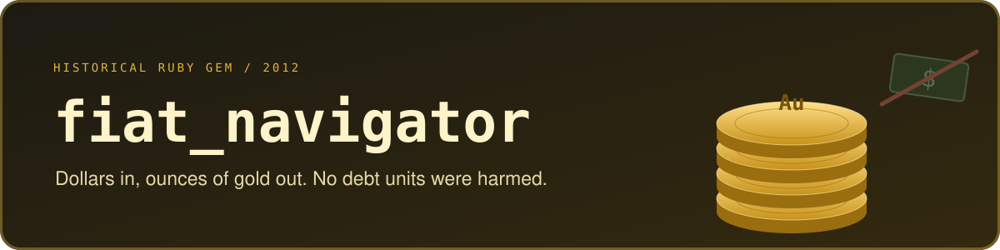
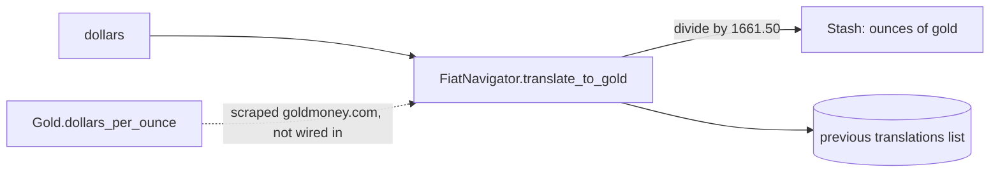

<p align="center"></p>

<p align="center">
  
  
  
</p>

> [!NOTE]
> **Historical project (March 2012).** Written over one weekend for Ruby 1.9 and Minitest 3, and not maintained since. Kept for the record. Only the dollars-to-gold half works today, and it uses a fixed price from 2012, not a live one. Details in [docs/STATUS.md](docs/STATUS.md).

# fiat_navigator

We all hate the trickiness of the fiat debt units issued by governments worldwide and would prefer to do business in real money. **fiat_navigator** (this repo is called `fiat`) is a tiny Ruby gem that translates a dollar amount into a weight of gold, remembers what it translated, and flatly refuses to help you deal with the Federal Reserve.

It was Steven Zeiler's first public repo: sound money, a calculator, and a joke with a real error message in it.

## Features

- Translate dollars into ounces of gold (`FiatNavigator.translate_to_gold`).
- Keep a list of every translation made in the session.
- A `Stash` object that holds an amount, a unit and a kind of money, and prints as `"0.3009 ounces gold"`.
- `FiatNavigator.do_business_with_the_federal_reserve`, which returns a disappointed error message on purpose.
- A `Gold` helper that scraped goldmoney.com for the spot price (the site has since changed and the scraper no longer works).

## Install

The gem was never published to RubyGems. Build it from a clone:

```sh
git clone https://github.com/stevenzeiler/fiat.git
cd fiat
gem build fiat_navigator.gemspec
gem install fiat_navigator-0.0.2.gem
```

(The original README cloned from `stevenzeiler/fiat_navigator`, the repo's earlier name. The committed `fiat_navigator-0.0.1.gem` is an older build.)

## Usage

```ruby
require 'fiat_navigator'
# => true
```

I want to pay a friend about the value of $500, in gold:

```ruby
gold = FiatNavigator.translate_to_gold 500, :dollars

puts gold          # => "0.3009 ounces gold"
puts gold.unit     # => :ounces
puts gold.amount   # => 0.3009
```

I have gold but I need $500 cash, and must sell some:

```ruby
dollars = FiatNavigator.translate_to_dollars 0.2, :ounces, :gold
# README of 2012: "332.30 dollars"
```

> [!WARNING]
> `translate_to_dollars` is described in the original README but was **never implemented**; calling it raises `NoMethodError`. Silver is also mentioned in the pitch and not implemented.

I have 0.2 ounces gold but I need to move it into the mainstream banking or financial system:

```ruby
FiatNavigator.do_business_with_the_federal_reserve
# => "Error: Hopefully this tool will not be used to facilitate such disappointing behavior."
```

I want to review the last full translation, or all of them from this session:

```ruby
FiatNavigator.previous_translation
FiatNavigator.all_previous_translations
# => ["500 dollars translates to 0.3009 ounces gold", ...]
```

The original README promised "real time gold prices from goldmoney.com":

```ruby
Gold.dollars_per_ounce   # => "$1,653.60"  (2012)
Gold.dollars_per_gram    # => "$53.1636"   (2012)
```

> [!CAUTION]
> The goldmoney.com page this scraped is gone or changed, and the call (`open` on a URL) no longer works on modern Ruby. The translation itself never used it: `translate_to_gold` divides by a constant, **$1,661.50 per ounce**.

## How it works



## Project layout

```
lib/fiat_navigator.rb          the FiatNavigator module and its class methods
lib/fiat_navigator/stash.rb    Stash: amount, unit, money, to_s
lib/fiat_navigator/gold.rb     Gold: Nokogiri scrape of goldmoney.com (dead)
test/                          Minitest tests (stash, navigator, gold)
Rakefile                       rake test
fiat_navigator.gemspec         gem v0.0.2
fiat_navigator-0.0.1.gem       a committed build (kept, not rebuilt)
docs/                          status notes and this README's banner
```

## History

- **2012-03-16:** first commit (a README at 00:56), then about 20 commits overnight: gem skeleton, first passing tests, translation history, scraped prices, gemspec v0.0.2.
- **2012-03-17:** spacing fixes in the tests. Last commit. 24 commits in all, one weekend.
- It is the oldest repo on this account, and the start of an interest in sound money that later led into cryptocurrency work.

---

Status and what is broken: [docs/STATUS.md](docs/STATUS.md) · Notes for AI agents: [AGENTS.md](AGENTS.md)
